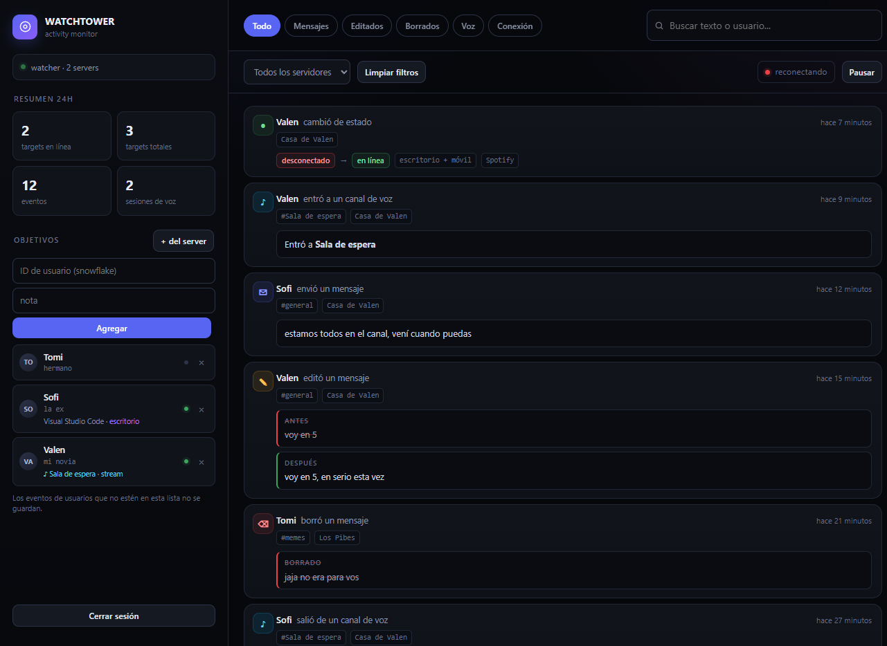

# Trace by XYB

**Trace by XYB** · monitor de actividad de Discord sobre una **user token** (cuenta propia): gateway en vivo, persistencia en Supabase y un dashboard web para ver todo. Pensado para seguir a un grupo chico de usuarios objetivo dentro de los servidores donde ya está la cuenta.

La configuración se carga **desde el panel**: token de Discord, claves de Supabase y objetivos. No hace falta editar archivos ni reiniciar el proceso.



## Qué registra

| Evento | Tipo en DB | Qué guarda |
|---|---|---|
| Mensaje enviado | `message` | texto, server, canal, autor, adjuntos, reply |
| Mensaje editado | `message_edit` | **contenido anterior**, contenido nuevo, server, canal |
| Mensaje borrado | `message_delete` | último contenido conocido |
| Entrada a voz | `voice_join` | canal de voz, server |
| Salida de voz | `voice_leave` | canal, server y **cuánto tiempo estuvo** |
| Cambio de canal | `voice_move` | canal anterior, canal nuevo, server |
| Stream / cámara | `voice_stream`, `voice_camera` | estado de transmisión o cámara |
| Conexión / desconexión | `presence` | estado anterior → estado nuevo, actividad (Spotify, juego), **dispositivo** (escritorio, móvil, navegador), server |
| Cambio de perfil | `profile_update` | **nombre, display, avatar y banner** (con URLs antes/después), **apodo** del servidor, origen (`user` / `member`) |

Los mensajes solo se ven en servidores mutuos (es lo único a lo que la cuenta tiene acceso). La presencia llega por el gateway de Discord; en servers muy grandes Discord puede limitar el envío de presencias, en servers chicos/medianos anda completo.

## Stack

- Node 22 / Express
- `discord.js-selfbot-v13` para el gateway con user token
- Supabase (Postgres + API REST) — free tier
- SSE para el feed en vivo (sin websockets extra)
- Railway para el host — free trial / Hobby

```
schema.sql              tablas (targets, events, accounts) + índices + RLS + prune_events
src/settings.js         API keys, key de registro y configuración en caliente (env + data/settings.json)
src/accounts.js         cuentas, scrypt, HWID y sesiones (Supabase o data/accounts.json)
src/net.js              fetch con deadline, reintentos y causa real del error
src/config.js           perillas de arranque (puerto, TRACK_ALL, targets semilla)
src/db.js               cliente Supabase perezoso + probe + insert batch
src/targets.js          cache de objetivos (refresh cada 20s, backoff si falla)
src/queue.js            buffer de escritura (40 eventos / 700ms)
src/bot.js              gateway: presencia, mensajes, edits, voz, connect/disconnect
src/server.js           API + auth por cookie + SSE + endpoints de ajustes
src/index.js            arranque + shutdown limpio
public/index.html       dashboard (vanilla, sin build)
scripts/demo.js         demo con datos falsos, sin credenciales
scripts/smoke.js        test end-to-end del pipeline
```

---

## Inicio rápido

```bash
npm install
npm start
```

Abrí `http://localhost:3000`. En el primer arranque el panel pide **crear la cuenta** (usuario + contraseña + **key de acceso**); después abre solo la ventana de **Ajustes** para pegar:

1. **Discord** → token de la cuenta que mira → *Guardar y conectar*.
2. **Supabase** → Project URL + secret key → *Guardar* → *Probar conexión*.
3. **Objetivo** → ID del usuario a seguir → *Agregar objetivo*.

Todo eso queda guardado en `data/settings.json` (modo 600, fuera del repo). El token y las claves nunca se devuelven completos al navegador: el panel muestra solo un preview (`sb_sec…6POS2-`, `MTU2…_Zfk`).

### Precedencia de configuración

`variable de entorno` > `data/settings.json` > vacío.

Si una variable está definida (por ejemplo `DISCORD_TOKEN` en Railway), el panel la muestra en amarillo como *definida por variable de entorno* y no deja pisarla. Es a propósito: en un deploy las env son la verdad.

### Cuenta, key de acceso y HWID

Las cuentas viven en la tabla `accounts` de Supabase (con `data/accounts.json` como fallback local). Para **crear una cuenta** hacen falta usuario, contraseña y la **key de acceso**:

- Definila en el deploy con `ACCESS_KEY` (o `REGISTRATION_KEY`). Es la que repartís.
- Si no la definís, el server genera una y la imprime en el log del arranque (`[auth] ACCESS_KEY generada…`). También la puede revelar un admin desde **Ajustes → Cuenta → Ver key**.

Cada cuenta queda **atada al dispositivo** que la creó: el navegador calcula un identificador estable (`localStorage` + huella del navegador) y el server guarda solo su sha256. Un login desde otro dispositivo devuelve *“Esta cuenta está vinculada a otro dispositivo”*.

- Para mover una cuenta de equipo: **Ajustes → Cuenta → Desvincular dispositivo** (pide la contraseña) y volver a entrar.
- Si el equipo original ya no existe, en el login está **“Cambié de dispositivo”**: con usuario + contraseña + key de acceso se reata la cuenta al equipo nuevo. Ese proceso cierra las sesiones viejas.
- Cambiar la contraseña o desvincular el HWID sube `session_version`, así que las cookies anteriores dejan de valer.

`DASHBOARD_USERNAME` / `DASHBOARD_PASSWORD` siguen funcionando como **cuenta legacy del deploy**: entran sin HWID y se migran solas a la base en el primer login. La contraseña de esa cuenta se cambia en las variables del deploy, no desde el panel. Si no usás esas variables y el disco es efímero, igual no perdés el acceso: las cuentas y el HWID quedan en Supabase (corré `schema.sql`).

### API keys

En **Ajustes → API keys** se crean tokens `xyb_…` para scripts. El token completo se muestra **una sola vez**; el server guarda solo su hash sha256. Se usan con `Authorization: Bearer xyb_…` o `x-api-key: xyb_…`, se pueden revocar y las rutas sensibles (credenciales, cuenta, bot) siguen exigiendo cookie de sesión.

```bash
curl -H "x-api-key: xyb_..." https://tu-deploy/api/summary
curl -H "Authorization: Bearer xyb_..." https://tu-deploy/api/events?limit=20
```

## Demo sin credenciales

```bash
npm run demo
```

Abre `http://localhost:3311`, usuario `admin`, contraseña `demo` (key de registro: `demo-key-1234567890`). Carga 3 objetivos de mentira, eventos de todos los tipos y un mensaje nuevo cada 30s para ver el feed en vivo. No toca Supabase ni Discord.

## 1. Supabase

1. Crear proyecto en https://supabase.com (free).
2. **SQL Editor → New query** → pegar todo `schema.sql` → **Run**.
3. **Project Settings → API** → copiar:
   - `Project URL` → se pega en Ajustes → Supabase (o `SUPABASE_URL`).
   - `service_role` key (secret) → se pega en Ajustes → Supabase (o `SUPABASE_SERVICE_KEY`).

La `service_role` bypassea RLS. No la pongas en el frontend ni en un repo público. La clave pública (`sb_publishable_…`) **no sirve** para el server: RLS está cerrado y el panel la rechaza con un mensaje explícito.

Si el panel dice *"Falta correr schema.sql"*, faltó el paso 2.

## 2. Token de Discord

1. Abrir Discord en el navegador, logueado con la cuenta que va a monitorear.
2. DevTools (F12) → **Application → Local Storage → https://discord.com** → campo `token`.
3. Pegarlo en Ajustes → Discord → *Guardar y conectar*.

El panel valida el token contra `GET /users/@me` antes de conectar y muestra la cuenta resuelta (`tu_cuenta · 123456789012345678`) y la cantidad de servidores. Si el token está vencido o revocado, lo dice ahí mismo.

Es una selfbot: va contra los ToS de Discord y la cuenta puede ser baneada. Usá una cuenta secundaria, nunca la principal.

## 3. Correr local

```bash
npm install
npm start
```

Dashboard: `http://localhost:3000`. La cuenta se crea en el primer arranque o se define con `DASHBOARD_USERNAME` + `DASHBOARD_PASSWORD`.

Antes de conectar la cuenta real podés verificar que el pipeline anda:

```bash
npm test
```

## 4. Agregar objetivos

Tres formas:

- **Ajustes → Objetivo**: pegar el ID (snowflake, 17–20 dígitos) y una nota. El nombre se resuelve solo si la cuenta está conectada; si no, queda el ID hasta el primer evento.
- **Sidebar → `+ del server`**: elegir servidor → buscar por nombre → *Agregar*.
- **`TARGETS`** en el entorno: IDs separados por coma, se suman a los de la DB.

El ID se saca con clic derecho en el usuario → *Copiar ID* (con modo desarrollador activado).

Se guardan en la tabla `targets`. Solo los usuarios de esa lista generan eventos, salvo que pongas `TRACK_ALL=true` (loguea todo el mundo en todos los servidores, ojo con el volumen).

En el panel, click en un objetivo filtra todo el feed por esa persona.

## 5. Deploy en Railway

1. Subir el repo a GitHub.
2. Railway → **New Project → Deploy from GitHub repo**.
3. Variables (Service → Variables): `DISCORD_TOKEN`, `SUPABASE_URL`, `SUPABASE_SERVICE_KEY`, `ACCESS_KEY`, `SESSION_SECRET`. Opcionalmente `DASHBOARD_USERNAME` + `DASHBOARD_PASSWORD` como cuenta legacy de respaldo.
4. Railway inyecta `PORT` solo. `railway.json` ya define `npm start`, healthcheck en `/health` y restart on failure.
5. **Settings → Networking → Generate Domain** para tener URL pública.

No hace falta build step: Nixpacks detecta Node y corre `npm install`.

**Persistencia**: el filesystem de Railway es efímero. Las cuentas, objetivos y eventos viven en Supabase; en `data/` solo quedan las API keys, la configuración cargada desde el panel y la key de registro autogenerada. Si usás el panel para cargar credenciales, montá un **Volume** en `/app/data` (o definí `DATA_DIR`) o pasá todo por variables de entorno. Para que la key de registro sobreviva a los redeploys, definí `ACCESS_KEY`.

### Si aparece `TypeError: fetch failed`

El server ahora envuelve todas las llamadas a Supabase con deadline y reintentos, y describe la causa real (`ENOTFOUND`, `EAI_AGAIN`, `ECONNRESET`, timeout). Si el panel muestra *“Base de datos: …”* o los logs dicen `[targets] no se pudo refrescar`:

1. **Ajustes → Supabase → Probar conexión**. El botón pega contra `GET /rest/v1/targets` y distingue URL inválida, key rechazada y tabla faltante.
2. Verificá que `SUPABASE_URL` sea la **Project URL** (`https://<ref>.supabase.co`), no la conexión directa `db.<ref>.supabase.co` ni el pooler.
3. Verificá que `SUPABASE_SERVICE_KEY` sea la **service_role** (no la publishable/anon).
4. Corré `schema.sql` completo: si falta la tabla `accounts` o `targets`, el panel lo dice.
5. `GET /health` devuelve `db`, `bot` y `targetsError` para ver el estado sin entrar al panel.

---

## Variables de entorno

Todas son opcionales: sin ninguna, el panel arranca en modo setup.

| Variable | Para qué |
|---|---|
| `DISCORD_TOKEN` | user token de la cuenta que mira (bloquea el campo en el panel) |
| `SUPABASE_URL` | URL del proyecto Supabase |
| `SUPABASE_SERVICE_KEY` | service_role key |
| `ACCESS_KEY` | key que se pide para crear cuentas nuevas (si falta se genera y se loguea) |
| `REGISTRATION_KEY` | alias de `ACCESS_KEY` |
| `DASHBOARD_USERNAME` | cuenta legacy del deploy (por defecto `admin` si hay `DASHBOARD_PASSWORD`) |
| `DASHBOARD_PASSWORD` | contraseña de la cuenta legacy; entra sin HWID y se migra a la base |
| `SESSION_SECRET` | firma de la cookie; si falta se genera y se guarda en `data/settings.json` |
| `PORT` | 3000 por defecto; Railway lo inyecta |
| `TRACK_ALL` | `true` = loguear todos, no solo los targets |
| `TARGETS` | IDs extra separados por coma (se suman a la DB) |
| `SELF_PRESENCE` | `online`, `idle`, `dnd` o `invisible` para el estado de la propia cuenta |
| `ALERT_WEBHOOK` | webhook de Discord: avisa conexión/desconexión, voz y stream |
| `DATA_DIR` | carpeta de `settings.json` (por defecto `./data`) |

## API

| Método | Ruta | Para qué |
|---|---|---|
| GET | `/api/setup` | estado del primer arranque (`needsSetup`) |
| POST | `/api/register` | `{ username, password, key, hwid, hwid_label }` → crear cuenta y cookie |
| POST | `/api/setup` | alias histórico de `/api/register` |
| POST | `/api/login` | `{ username, password, hwid, hwid_label }` → cookie firmada 7 días |
| POST | `/api/recover-device` | `{ username, password, key, hwid }` → reatar la cuenta a otro dispositivo |
| POST | `/api/logout` | cerrar sesión |
| GET | `/api/session` | chequear sesión (`authType`), usuario y si falta setup |
| GET | `/api/registration-key` | ver la key de acceso (solo admin y cookie) |
| POST | `/api/account` | `{ username, current, password }` → cambiar usuario/contraseña (solo cookie) |
| DELETE | `/api/account/hwid` | `{ password }` → desvincular el dispositivo y cerrar sesiones (solo cookie) |
| GET/POST/DELETE | `/api/keys` | crear, listar y revocar API keys (solo cookie) |
| GET | `/api/settings` | configuración enmascarada + estado del bot (solo cookie) |
| PUT | `/api/settings` | guardar token/keys/webhook/presencia (reconecta en caliente, solo cookie) |
| POST | `/api/settings/test` | probar credenciales sin guardarlas (solo cookie) |
| POST | `/api/bot/connect` | conectar el gateway con el token guardado (solo cookie) |
| POST | `/api/bot/disconnect` | desconectar el gateway (solo cookie) |
| GET | `/api/summary` | contadores 24h, estado del bot, presencia, voz, actividad actual y avatares de los objetivos |
| GET | `/api/events` | `type, guild, user, q, limit, offset` |
| GET | `/api/stream` | SSE con los eventos nuevos |
| GET/POST/DELETE | `/api/targets` | gestionar objetivos |
| GET | `/api/guilds` | servidores de la cuenta |
| GET | `/api/members` | `guild, q` → buscar miembros |
| GET | `/health` | healthcheck para Railway |

## Notas técnicas

- **Configuración en caliente**: guardar credenciales desde el panel reconstruye el cliente de Supabase y reconecta el gateway sin reiniciar el proceso. Los errores de conexión se muestran en el diálogo, no en la consola.
- **Batch de escritura**: los eventos se agrupan (40 por lote / 700ms) antes de tocar Supabase. Si la DB falla, el lote se reintenta cada 3s hasta 5 veces; la cola tiene techo de 5000 para no comerse la RAM.
- **Transiciones reales**: presencia y voz salen de packets crudos (`PRESENCE_UPDATE`, `VOICE_STATE_UPDATE`), con un Map de estado anterior. La misma conexión llega una vez por cada guild en común y se loguea una sola vez.
- **Edits sin cache**: cuando llega un `messageUpdate` sin contenido viejo, se busca el original en `events` por `message_id`. Por eso también funciona después de un reinicio del bot. Si el original es anterior al bot, queda `metadata.original_known = false`.
- **Voz con duración**: al salir o moverse se calcula cuánto estuvo en el canal desde el join.
- **Perfil con baseline**: `USER_UPDATE` y `GUILD_MEMBER_UPDATE` llegan sin el estado anterior, así que el bot guarda en memoria el último perfil visto por usuario (y el apodo por servidor). Al conectar siembra ese baseline desde la cache, y en cada packet emite un solo `profile_update` con `metadata.changes`, `before`, `after`, `source` e `initial`. Los avatares/banners animados (`a_…`) se resuelven como `.gif`; sin avatar se usa el default que corresponde al id.
- **Presencia al arranque**: se siembra el estado actual desde la cache de guilds, así el panel muestra quién está online sin esperar a que cambie.
- **Retención**: los eventos no se borran solos. Limpieza manual o `pg_cron`:
  ```sql
  select cron.schedule('prune-events', '0 3 * * *', $$select prune_events(90)$$);
  ```
- **Seguridad del dashboard**: cookie HMAC HttpOnly (+ `Secure` detrás de HTTPS) con `session_version` revocable, contraseñas con scrypt + salt, HWID como sha256, API keys hasheadas con sha256 y visibles una sola vez, rate limit de intentos fallidos (10/min por IP), `noindex`, secretos enmascarados en la API.
- **Red resiliente**: `src/net.js` pone deadline de 12s y reintenta solo conexiones que todavía no se establecieron (no duplica escrituras). `targets.refresh` entra en backoff de 30s tras un fallo y el panel muestra el error real en vez de quedar mudo.
- **Webhook opcional**: `ALERT_WEBHOOK` manda un mensaje a un webhook de Discord en cada conexión/desconexión, entrada/salida de voz y stream.
